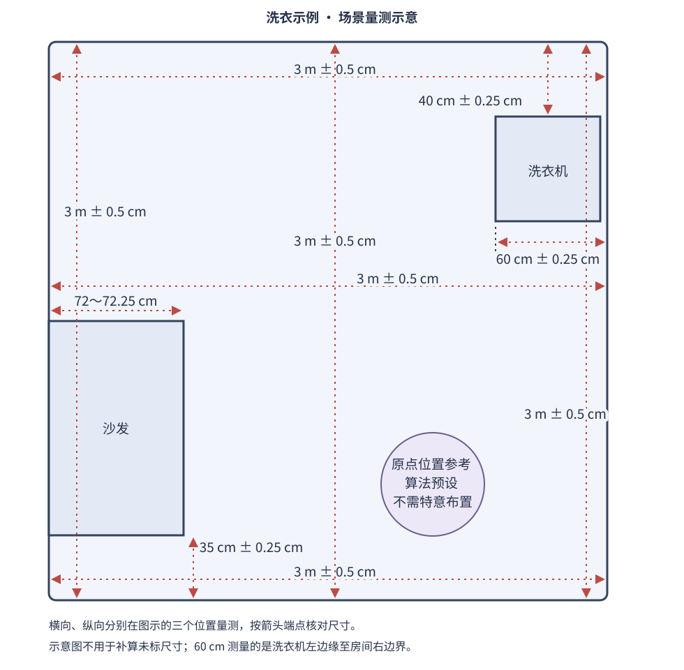

# H1 智能版洗衣示例运行包

本运行包用于 H1 智能版的八步洗衣演示，包含已编译的动作程序、ROS 2 接口、网页服务、视觉模型和配套地图。安装 Python 依赖后即可运行，客户无需安装 `colcon` 或编译业务 C++ 代码。

运行环境为 **Ubuntu 24.04 ARM64、ROS 2 Jazzy、Python 3.12**，使用交付设备的原生 **Zenoh（`rmw_zenoh_cpp`）**。机器人主控提供 SDK 服务，洗衣应用运行在智能版计算板上。

## 下载运行包

当前候选版本为 **2026.10.21-rc1**，适用于 Ubuntu 24.04 ARM64 / ROS 2 Jazzy / Python 3.12。请从 [Release 附件](https://github.com/onerobot-sdk/h1-examples/releases/tag/laundry-runtime-2026.10.21-rc1) 下载 `h1-laundry-runtime-2026.10.21-rc1-linux-aarch64.tar.gz` 与同名 `.sha256` 文件。

此版本为预发布运行包。先完成下文的环境检查与模拟模式，再按当前机器人、相机标定和场景进行真机单步验收；该运行包尚未完成真机全流程验收。

```bash
sha256sum -c h1-laundry-runtime-2026.10.21-rc1-linux-aarch64.tar.gz.sha256
tar -xzf h1-laundry-runtime-2026.10.21-rc1-linux-aarch64.tar.gz
cd h1-laundry-runtime
```

仓库的 **Code → Download ZIP** 只包含示例说明、标准版源码和地图，不包含洗衣运行程序。运行包包含已编译的 C++ 程序，Python、网页及配置文件保持可读；不提供洗衣业务 C++ 源码。

## 1. 设备与文件

准备 H1 智能版，以及头部、左臂、右臂位置的 D435 或安思疆深度相机。彩色图、深度图、相机内外参和手眼标定必须匹配当前设备。相机或机器人更换后，应重新核对标定与动作参数。

解压后保留以下目录结构：

| 路径 | 用途 |
| --- | --- |
| `install/` | 六个 ROS 包的运行文件、动态库、接口、网页、模型和 URDF |
| `scripts/` | Python 环境准备、检查、模拟及真机启动入口 |
| `config/local.env.example` | 本机环境配置模板，默认使用原生 Zenoh、domain 0 |
| `wheelhouse/` | 与目标环境匹配、版本锁定的 ARM64 Python 安装轮子 |
| `maps/h1-laundry-map.zip` | 与示例场景配套的地图包 |
| `licenses/` | 随包第三方许可与声明 |
| `requirements.txt`、`constraints.txt` | Python 依赖及版本约束 |
| `manifest.json` | 交付组件与环境信息 |
| `assets.sha256` | 交付文件完整性校验 |

不要从其他电脑复制 `.venv/`。应在最终运行目录创建 Python 环境；移动运行包后需要在新位置重新创建环境。

## 2. 安装与离线检查

以下命令均在智能版计算板的 Bash 终端执行。将运行包解压到有写权限的目录，并进入 `h1-laundry-runtime/`：

```bash
cd /path/to/h1-laundry-runtime
sha256sum -c assets.sha256
cat /etc/os-release
dpkg --print-architecture
/usr/bin/python3 --version
test -f /opt/ros/jazzy/setup.bash
test -f config/local.env || cp config/local.env.example config/local.env
bash scripts/check_system.sh
bash scripts/setup_python.sh
.venv/bin/python -m pip check
bash scripts/doctor.sh
```

环境应为 Ubuntu 24.04 / noble、`arm64`、Python 3.12.x，并已预装 ROS 2 Jazzy 和所需系统运行库。`check_system.sh` 只读检查系统包，打印缺失项与安装建议，不安装软件。`setup_python.sh` 在当前包目录创建 `.venv`，默认从随包 `wheelhouse/` 离线安装固定版本的 Python 依赖。本包不包含系统镜像或 ROS、apt 系统包的离线安装介质。

`pip check` 应显示 `No broken requirements found.`。`doctor.sh` 只做离线检查，不连接 ROS 图或下发机器人命令。检查成功说明本地运行环境与资源可用，不代表机器人通信、地图、定位和动作点位已适配。

系统或动态库缺失时，按 [依赖说明](DEPENDENCIES.md) 补齐与交付环境匹配的运行依赖，再重新检查。

## 3. 先运行模拟模式

```bash
bash scripts/run_mock.sh
```

默认在运行应用的计算板监听 `127.0.0.1:8088`。在同一设备的浏览器打开 `http://127.0.0.1:8088/`，可查看页面、运行模拟八步流程和查看状态变化。此脚本固定为模拟模式并强制关闭控制，不启动动作节点，也不连接机器人。

如需在设备已配置的可访问地址监听，可指定主机地址和端口。例如：

```bash
H1_LAUNDRY_HOST=0.0.0.0 H1_LAUNDRY_PORT=8088 bash scripts/run_mock.sh
```

此时在电脑浏览器访问 `http://<计算板可访问地址>:8088/`。`0.0.0.0` 是监听配置，不能作为浏览器访问地址。结束模拟模式请在启动终端按 `Ctrl+C`；模拟与真机模式不要同时运行。

## 4. 场景与地图

场景采用沙发在左侧、洗衣机在右上方的配套布局。准备待抓取衣物，并按交付要求放置供右腕相机识别的红色标记。按下表实测并记录尺寸，方向以配套场景图为准。



| 测量项目 | 要求 |
| --- | --- |
| 房间左边界至右边界 | 上、中、下三个位置分别量测：3 m ± 0.5 cm |
| 房间上边界至下边界 | 左、中、右三个位置分别量测：3 m ± 0.5 cm |
| 房间左边界至沙发右边缘 | 72～72.25 cm |
| 沙发下边缘至房间下边界 | 35 cm ± 0.25 cm |
| 房间上边界至洗衣机上边缘 | 40 cm ± 0.25 cm |
| 洗衣机左边缘至房间右边界 | 60 cm ± 0.25 cm |

图中原点仅作位置参考，不需要另设原点标记，也不要据此随意搬动机器人。未标注的家具尺寸不能按图片比例推算。现场、地图、红色标记、动作点位、手眼标定和夹爪参数应与配套场景一致；本地图不能直接用于任意房间。

通过机器人 8090 页面导入地图：

1. 如需保留当前现场地图，先在机器人页面导出备份。结束正在进行的建图、导航及机械臂老化测试。
2. 在电脑浏览器打开 `http://<机器人 IP>:8090/`，进入 **算法测试 → 地图 → 导入地图包**。
3. 选择运行包中的 `maps/h1-laundry-map.zip`，保持原始 ZIP，不解压或重新打包。
4. 点击 **导入地图**并确认替换当前地图。页面显示“已下发地图导入”后，核对地图画面与元信息已更新。
5. 进入 **定位**页启动定位，并以机器人定位反馈确认成功。

“已下发”只表示请求已发送。地图未生效或定位未成功时，不启动洗衣动作。

## 5. 真机连接与操作

沿用设备交付的 Zenoh Router/Session 配置。运行前核对 `config/local.env` 中的 `RMW_IMPLEMENTATION=rmw_zenoh_cpp`、`ROS_DOMAIN_ID=0`，并确认双板通信服务正常；不要同时运行另一套洗衣任务节点。模板不替代设备原有的 Router/Session 配置。

```bash
bash scripts/run_live.sh
```

真机模式会启动动作节点及网页／视觉节点。请在页面确认头部、左腕、右腕的图像、深度及机器人状态持续更新，模型状态为就绪。

真机网页的监听地址与端口由 `install/h1_laundry/share/h1_laundry/config/default.yaml` 中的 `server.host`、`server.port` 配置，默认为 `127.0.0.1:8088`。需要调整时，在停止应用后修改配置并重启；`H1_LAUNDRY_HOST`、`H1_LAUNDRY_PORT` 仅用于 `run_mock.sh`。已有 `runtime/config_overrides.yaml` 中的 `server` 设置会覆盖默认配置，也应一并核对。

首次运行的 `safety.control_enabled` 为 `false`，洗衣动作保持锁定。现场和参数核对完成后，停止应用，在 `runtime/config_overrides.yaml` 中合并以下配置；已有文件应保留其他配置项：

```yaml
safety:
  control_enabled: true
```

重新执行 `bash scripts/run_live.sh`，确认动作区域清空、物理急停可用，再在网页点击 **真机解锁**并输入 **解锁真机**。先逐步验证，再运行全流程。

网页的 **启动定位** 独立于洗衣动作解锁，真机模式下会发送定位请求。它使用配套的充电位置初始化流程，应确认机器人处于该方式适用的位置；点击后等待定位反馈，不能把“已下发”当作成功。洗衣任务运行期间不能重新启动定位。

| 步骤 | 动作 |
| --- | --- |
| 1 | 搜索衣服 |
| 2 | 靠近衣服 |
| 3 | 抓取衣服 |
| 4 | 转向并搜索洗衣机 |
| 5 | 靠近洗衣机 |
| 6 | 识别红色标记并开门 |
| 7 | 放入衣服 |
| 8 | 关门、后退、双臂与升降机构复位，并返回流程起点 |

**当前流程不包含按下洗衣机启动按钮。** 网页断连告警不等于机器人自动停止，物理急停不能由网页替代。

## 6. 参数、日志与更新

默认应用配置位于 `install/h1_laundry/share/h1_laundry/config/default.yaml`；动作点位、姿态与手眼参数位于 `install/grasp/share/grasp/config/grasp_params.yaml`。应用的本机覆盖配置保存在 `runtime/config_overrides.yaml`，网页参数修改也写入此文件。修改运动参数后须重新核对现场并进行单步验证。

运行日志和诊断记录位于 `runtime/`。网页右上角的 **导出诊断包** 可下载排障材料；网页不可用时，可执行 `bash scripts/export_diagnostics.sh` 离线收集本运行包 `runtime/` 中的诊断材料。提交排障材料时，应附上 `manifest.json` 和检查脚本的错误输出。

升级时保留旧运行包及其 `runtime/`，把新版解压到另一目录，重新创建 `.venv` 并完成离线检查、模拟预览和现场核对后再切换。不要在任务执行中替换运行文件。
